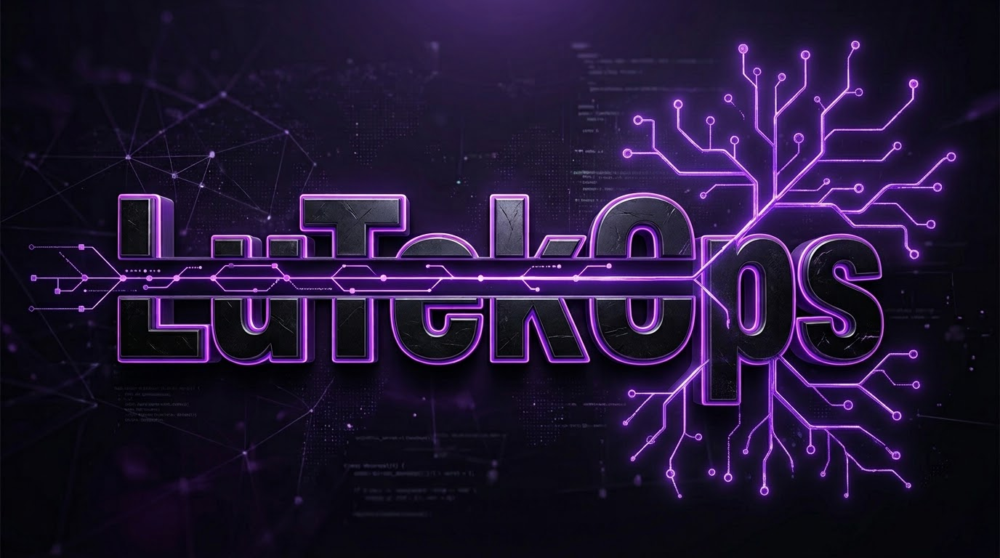

<h1 align="center">Hi, I'm Luca 👋</h1>

<b>Indie dev from Switzerland · Apps & games for Android</b> 
<i>I turn ideas into software, ideally with clean code, solid tests a lot of coffee and a touch of chaos. ⚡</i>

---

### 🧑‍💻 About me
- 📱 I build Android apps and mobile games, from first idea to the Play Store
- 🌍 My projects usually speak several languages (EN · DE · FR · IT · ES · PT-BR)
- 🧪 Motto: *Plan first, then build.* And: tests green before anything ships
- 🤖 I like working with AI tools as a pair programmer
- 💬 Ask me about: Android, Firebase, Supabase, C, Java, Unity (and a lot more)

---

### 🛠️ Tech stack

